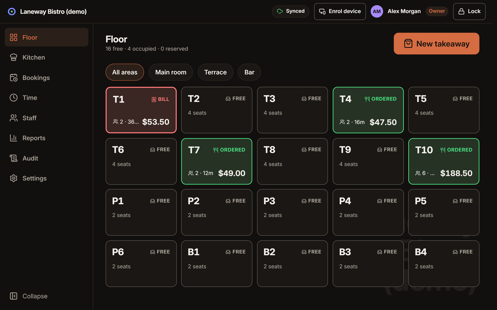
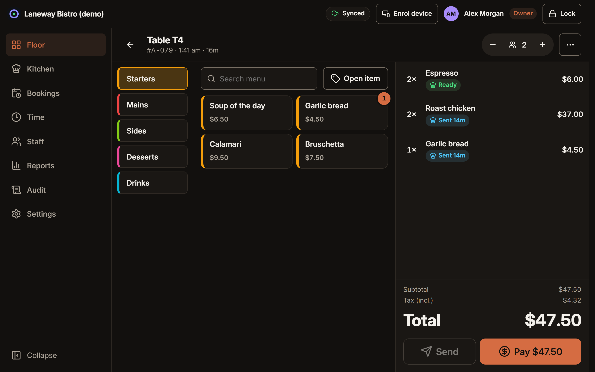
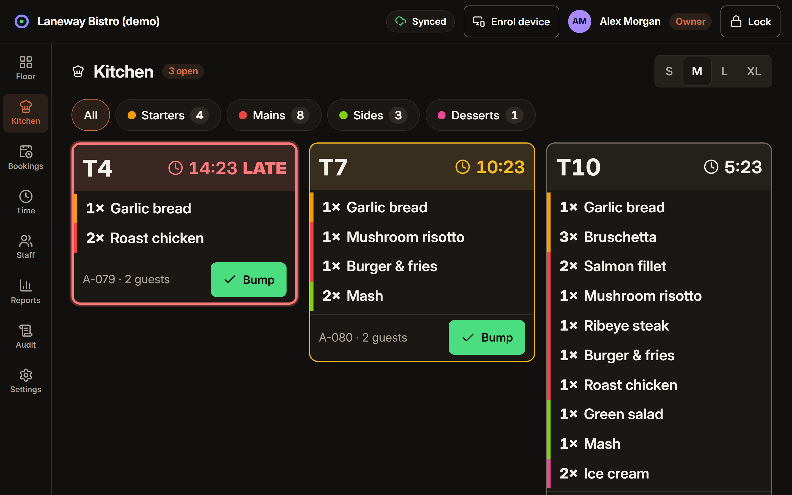
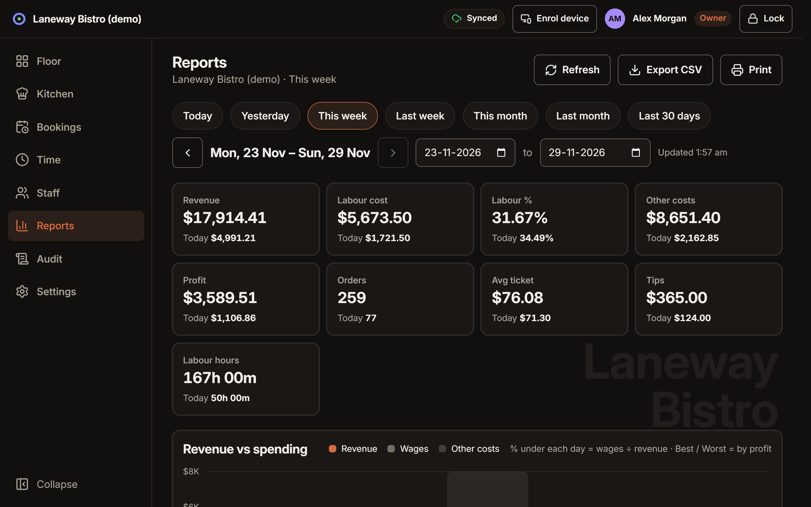
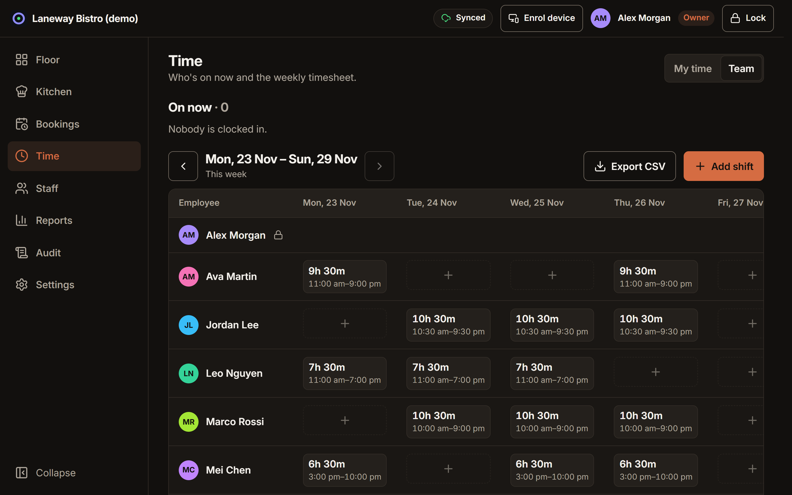
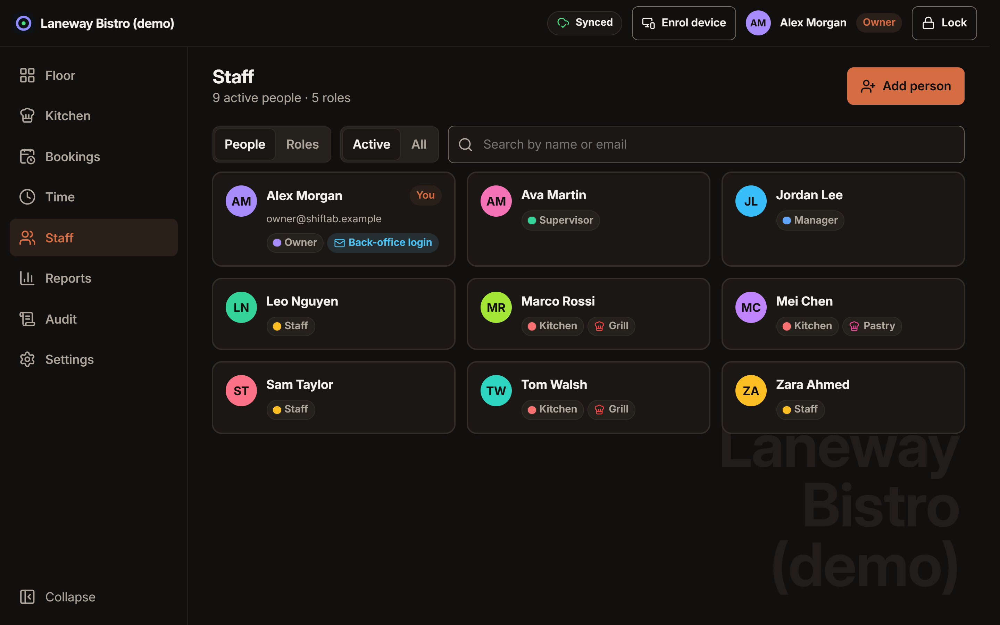
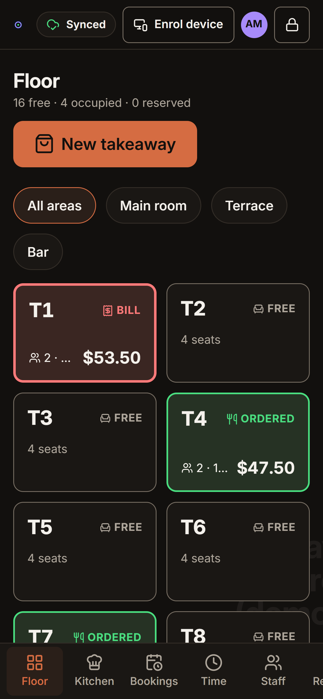

# Shiftab

An offline-first point-of-sale and labour-cost platform for hospitality — restaurants, cafés
and bars — built as a template other businesses can extend.

- **Front of house:** face-tile PIN sign-in, floor plan with live table states and running
  totals, fast order screen, live multi-device order editing, kitchen display for TVs with
  per-station course tabs,
  reservations, split payments with tips and cash change, on-the-spot manager approvals.
- **Time clock:** staff clock in/out from the sign-in screen, profile photos, attendance
  history, manager timesheet corrections (audited).
- **Back office:** revenue vs wages and other costs (equipment, stock, rent… spread over the
  period they serve) for any date range up to a year, labour %, profit; per-employee hours,
  breaks, overtime and pay due — CSV and print/PDF.
- **Works with no network.** Everything on the floor keeps working offline and syncs
  ("cloud save") when the server is reachable. Devices update each other in real time.
- **Your brand, not a template look:** palette presets or your own colour (picked straight
  from your logo), warm/cool/neutral backgrounds, Modern/Classic/Bold headings, corner style,
  and your logo on every screen. Every combination is auto-corrected to stay WCAG AA readable.
- **Secured by design:** hierarchical groups, password + optional TOTP for anything
  sensitive, signed changes from enrolled terminals, password-level approval for voids,
  discounts, refunds and timesheet edits, finance data encrypted at rest on the server and on
  devices, append-only audit log. See [PLAN.md §5](PLAN.md#5-security-model).

**Try it:** [shiftab-demo-production.up.railway.app](https://shiftab-demo-production.up.railway.app), a sample bistro
with four weeks of made-up trading. The sign-in is filled in for you, every staff PIN is 1234, and it starts fresh
about once an hour.

| | |
|---|---|
|  |  |
|  |  |
|  |  |

<p align="center"></p>

## Quick start (development)

Requires **Node.js ≥ 22.18**.

```sh
npm install
npm run build        # builds the PWA into dist/
npm start            # http://localhost:8080 — the setup code is printed in the log
```

For live-reloading UI work run both, then open http://localhost:5173:

```sh
npm run dev:server   # API on :8080
npm run dev:client   # Vite on :5173, proxies /api
```

Tests: `npm test` (money, business-day/overtime maths, permissions, end-to-end API
authorisation against a temporary database, and the public demo). Type-check: `npm run typecheck`.
Demo mode: `DEMO=1 npm start` (see [docs/DEPLOY.md](docs/DEPLOY.md#public-demo-demo1)).

## Documents

| | |
|---|---|
| [PLAN.md](PLAN.md) | Architecture, data model, sync protocol, security model, report maths |
| [docs/DEPLOY.md](docs/DEPLOY.md) | Hosting, HTTPS, setting up each device (iPad, Android, PC, TV), backups, security checklist |
| [docs/EXTENDING.md](docs/EXTENDING.md) | Adding modules, collections and permissions to the template |
| [docs/research/ui-ux.md](docs/research/ui-ux.md) | UI research: font, colour tokens, type scale, POS patterns |

## Layout

```
shared/   schemas, permissions, money/time/report maths (used by client, server and tests)
server/   Fastify API: auth, sync, staff, finance  (SQLite via node:sqlite)
src/      React PWA: lib/ (offline DB, sync, session), ui/ (kit), screens/, modules/
test/     node:test checks
docs/     deployment, extension guide, research
```

## Roles out of the box

Owner › Manager › Supervisor › Staff › Kitchen. Rename them, change their permissions or
add your own (e.g. Dishwasher, starting as a copy of Kitchen) in Staff → Roles, or straight from
Add person → Role → New role. Kitchen stations (sub-roles such as Tandoor or Desserts) are set up under
Staff → Roles too: people on a station see only its dishes on the kitchen screen, with a "Whole order" view. People can only manage those ranked below them, and
finance, staff, settings, devices and the audit log always need a password sign-in.
